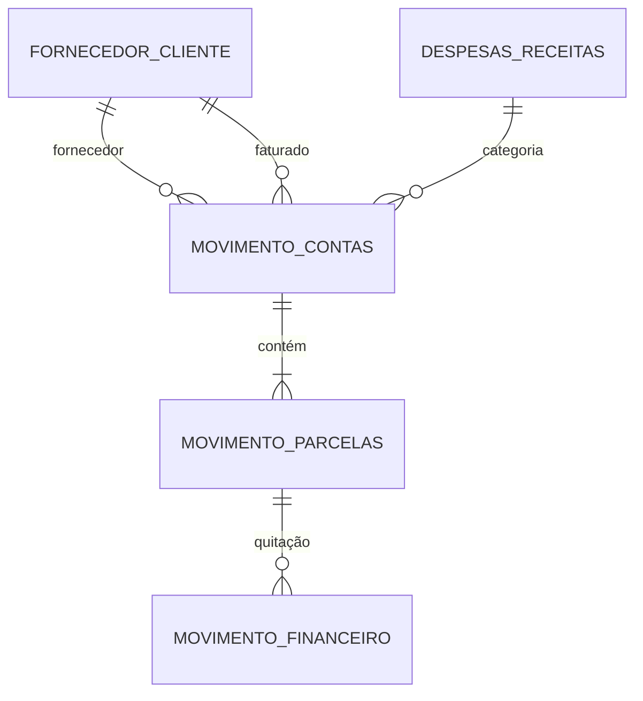

# AgroContas — Gestão Financeira Rural

Sistema administrativo-financeiro para produtores rurais familiares e gestores do agronegócio. Integra o controle tradicional de contas a pagar e a receber a um motor de **extração inteligente de Notas Fiscais Eletrônicas (NF-e/DANFE em PDF)** com o **Google Gemini**, que lê o documento, classifica a despesa, confere o cadastro no banco e lança a conta com suas parcelas.

> Projeto da disciplina de **Desenvolvimento Orientado a Objetos (DOO)** da **Universidade de Rio Verde (UniRV)**, desenvolvido pela Equipe de Desenvolvimento AgroContas.

## Sumário

- [Funcionalidades](#funcionalidades)
- [Requisitos funcionais](#requisitos-funcionais)
- [Tecnologias](#tecnologias)
- [Arquitetura](#arquitetura)
- [Modelo de dados](#modelo-de-dados)
- [Como executar](#como-executar)
- [Variáveis de ambiente](#variáveis-de-ambiente)
- [Banco de dados e migrações](#banco-de-dados-e-migrações)
- [Deploy](#deploy)
- [API](#api)
- [Documentação](#documentação)
- [Contribuindo](#contribuindo)

## Funcionalidades

- **Extração de NF-e por IA**: envio do PDF, leitura semântica via Gemini e retorno de dados estruturados (emitente, faturado, itens, impostos, parcelas), com visualização formatada e JSON bruto.
- **Resiliência na IA**: rodízio entre modelos Gemini (`gemini-3.5-flash-lite` → `gemini-3.1-flash-lite` → `gemini-2.5-flash-lite`) com retentativa automática em caso de falha.
- **Conferência no banco**: após a extração, o sistema verifica se Fornecedor, Faturado e Despesa já existem e permite lançar o registro com um clique.
- **Cadastros no padrão "Manter"**: listagem com filtros, DataGrid e ações *Consultar*, *Incluir Novo*, *Alterar* e *Desativar/Reativar*. Cadastros nunca são excluídos, apenas inativados.
- **Contas com parcelamento**: título mestre de contas a pagar/receber com desdobramento em parcelas e controle de saldo.
- **Chave de API própria**: o usuário pode informar a sua chave do Google AI Studio por um pop-up, sem depender da chave do servidor.
- **Última atualização no GitHub**: o cabeçalho da tela principal exibe a data e o hash do último commit da branch `main`, consultados na API pública do GitHub.

## Requisitos funcionais

| ID | Funcionalidade | Situação |
| :-- | :-- | :-- |
| RF01 | Manter Fornecedor / Cliente | Implementado (tela **Pessoas**) |
| RF02 | Manter Despesas / Receitas | Implementado (tela **Classificação**) |
| RF03 | Manter MovimentoContas | Implementado (tela **Contas**) |
| RF04 | Manter MovimentoParcelas | Implementado dentro do cadastro de **Contas** |
| RF05 | Manter MovimentoFinanceiro (Quitação) | Tabela criada; tela e endpoints de baixa ainda pendentes |
| RF06 | Fazer Upload do Documento | Implementado (tela **Extração de NF-e**) |
| RF07 | Extrair Dados do Documento | Implementado (Gemini) |

## Tecnologias

| Camada | Tecnologia |
| :-- | :-- |
| Frontend | Vue 3 (Composition API, `<script setup>`), TypeScript, Vite, Tailwind |
| Backend local | Node.js, Express, TypeScript, Multer |
| Backend em produção | Cloudflare Pages Functions |
| Banco de dados | SQLite local ou Cloudflare D1 |
| IA | Google Gemini (`@google/generative-ai`) com saída estruturada por schema |

## Arquitetura

```text
agrocontas/
├── docs/                         # Documentação de engenharia de requisitos
│   ├── DOCUMENTACAO_REQUISITOS_RESUMO.txt
│   ├── original/                 # Versão v1.01 e avaliação do professor
│   └── corrigida/                # Versão oficial v1.0 (PDF, LaTeX e diagramas)
├── agrocontas/
│   ├── backend/                  # API REST (Express + TypeScript), usada no desenvolvimento local
│   │   └── src/
│   │       ├── config/           # Variáveis de ambiente e upload (multer)
│   │       ├── controllers/      # Entrada/saída HTTP
│   │       ├── routes/           # Definição dos endpoints
│   │       ├── services/         # Regras de negócio, Gemini e acesso ao banco
│   │       ├── schemas/          # Schemas de validação e saída estruturada do Gemini
│   │       ├── db/               # Esquema e conexão (SQLite / D1)
│   │       └── types/
│   └── frontend/                 # SPA Vue 3 + Cloudflare Pages Functions
│       ├── functions/api/        # Endpoints em produção (espelham o backend)
│       ├── migrations/           # Migrações SQL do D1
│       └── src/
│           ├── components/       # FileUpload, FormattedViewer, JsonViewer, UltimaAtualizacaoGithub...
│           ├── views/            # Pessoas, Classificações, Contas
│           ├── services/         # Clientes HTTP
│           └── types/
├── AGENTS.md                     # Diretrizes para desenvolvedores e assistentes de IA
└── README.md
```

O backend segue camadas: `routes` declaram rotas, `controllers` validam e respondem, `services` concentram regra de negócio e integrações. As respostas usam o padrão `{ success, data?, error? }`.

## Modelo de dados

O banco implementa as 5 entidades do DER oficial:



O esquema completo está em [`agrocontas/frontend/migrations/0001_init.sql`](agrocontas/frontend/migrations/0001_init.sql) e deve permanecer idêntico a `agrocontas/backend/src/db/schema.ts`.

## Como executar

### Pré-requisitos

- Node.js 20 ou superior e npm
- Chave de API do Gemini ([Google AI Studio](https://aistudio.google.com/apikey))

### Opção 1 — Backend Express + frontend (desenvolvimento)

```bash
# Terminal 1: backend em http://localhost:3000
cd agrocontas/backend
npm install
cp .env.example .env        # preencha GEMINI_API_KEY
npm run dev

# Terminal 2: frontend em http://localhost:5173 (proxy de /api para o backend)
cd agrocontas/frontend
npm install
npm run dev
```

### Opção 2 — Emulando o Cloudflare Pages

```bash
cd agrocontas/frontend
npm install
npm run db:migrate:local    # cria o banco D1 local
npm run build
npm run pages:dev           # serve dist/ com as Functions e o D1 local
```

### Build de produção

```bash
cd agrocontas/backend  && npm run build   # compila o TypeScript
cd agrocontas/frontend && npm run build   # vue-tsc + vite build
```

## Variáveis de ambiente

Copie `agrocontas/backend/.env.example` para `.env`. **Nunca commite o `.env` nem chaves de API.**

| Variável | Descrição |
| :-- | :-- |
| `PORT` | Porta do backend (padrão `3000`) |
| `CORS_ORIGIN` | Origem permitida no CORS |
| `GEMINI_API_KEY` | Chave do Gemini usada pelo servidor |
| `GEMINI_MODEL` | Modelo padrão da extração |
| `DATABASE_PATH` | Caminho do arquivo SQLite local |
| `CF_ACCOUNT_ID`, `CF_DATABASE_ID`, `CF_API_TOKEN` | Opcionais. Se definidos, o backend usa o Cloudflare D1 na nuvem no lugar do SQLite local |

## Banco de dados e migrações

```bash
cd agrocontas/frontend
npm run db:migrate:local     # aplica as migrações no D1 local
npm run db:migrate:remote    # aplica as migrações no D1 da Cloudflare
```

## Deploy

O frontend e as Functions são publicados no **Cloudflare Pages** (`wrangler.toml` em `agrocontas/frontend`), com o banco no **D1** (binding `DB`). Configure `GEMINI_API_KEY` como *secret* no painel da Cloudflare; o modelo padrão fica em `[vars]`.

## API

Todas as rotas ficam sob `/api` e respondem `{ success, data?, error? }`.

| Recurso | Endpoints |
| :-- | :-- |
| NF-e | `POST /api/nfe/extract` (upload do PDF), `GET /api/nfe/config`, `POST /api/nfe/test-config` |
| Contas | `GET /api/contas`, `POST /api/contas`, `GET /api/contas/:id`, `PUT /api/contas/:id`, `PATCH /api/contas/:id/status`, `POST /api/contas/verificar`, `POST /api/contas/lancar` |
| Pessoas | `GET /api/pessoas`, `POST /api/pessoas`, `GET /api/pessoas/:id`, `PUT /api/pessoas/:id`, `PATCH /api/pessoas/:id/status` |
| Classificações | `GET /api/classificacoes`, `POST /api/classificacoes`, `GET /api/classificacoes/:id`, `PUT /api/classificacoes/:id`, `PATCH /api/classificacoes/:id/status` |
| Saúde | `GET /api/health` |

## Documentação

- Resumo em texto para leitura rápida: [`docs/DOCUMENTACAO_REQUISITOS_RESUMO.txt`](docs/DOCUMENTACAO_REQUISITOS_RESUMO.txt)
- Documentação oficial (PDF): [`docs/corrigida/AgroContas_Documentacao_Requisitos_v1.0.pdf`](docs/corrigida/AgroContas_Documentacao_Requisitos_v1.0.pdf)
- Guia da pasta `docs`: [`docs/README.md`](docs/README.md)
- README específico do backend: [`agrocontas/backend/README.md`](agrocontas/backend/README.md)

## Contribuindo

O repositório recebe contribuições de várias pessoas e assistentes de IA. Antes de alterar o código, leia o [`AGENTS.md`](AGENTS.md). Resumo das regras:

- Siga a documentação oficial: nenhuma entidade ou funcionalidade fora dos 7 RFs e das 5 tabelas do DER.
- Telas "Manter" começam sempre por uma listagem com filtros e DataGrid.
- Use TypeScript estrito (sem `any` injustificado) e `<script setup lang="ts">` no Vue.
- Use Conventional Commits (`feat:`, `fix:`, `docs:`, `refactor:`).
- Confirme que `npm run build` passa sem erros antes de entregar.

---

Equipe de Desenvolvimento AgroContas — UniRV, Desenvolvimento Orientado a Objetos.
